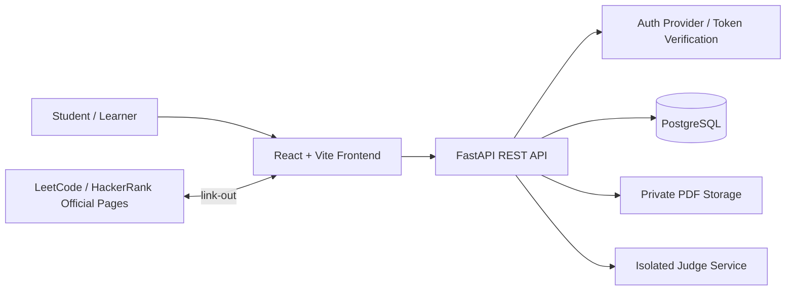

# 04: System Architecture

**Version:** 1.0

## 1. Context diagram

## 2. Main application modules
- Identity/profile
- DSA catalogue and submissions
- XP ledger and XP policy
- Leaderboard and friends comparison
- Learning courses, lessons, and final tests
- Self Study files and sessions
- Badge rules and user badge records

## 3. DSA submission flow
1. Authenticated user opens a problem.
2. Frontend sends problem ID, language, source code, and idempotency key.
3. API authenticates the user and checks problem availability.
4. Judge adapter submits code to an isolated judge.
5. Judge returns a verdict and safe execution metadata.
6. If verdict is correct, service begins a database transaction.
7. Insert submission record.
8. Attempt to insert XP award under unique `(user_id, problem_id)` constraint.
9. If first award, calculate XP from server-side policy and write ledger entry.
10. If already awarded, add no XP and record the repeat practice according to policy.
11. Commit transaction and return verdict, XP awarded this attempt, total XP, and practice count.

## 4. Leaderboard flow
1. Validate requested scope: college, district, state, or India.
2. Derive scope eligibility from verified profile fields.
3. Aggregate verified XP ledger entries or read a cache refreshed from that ledger.
4. Apply visibility rules and deterministic tie-breaker.
5. Return paginated ranking rows with only permitted public fields.

## 5. Friends comparison flow
1. Authenticate the current user.
2. Query only accepted/eligible friend relationships.
3. Join allowed profile fields and verified XP totals.
4. Apply each user's DSA visibility preference.
5. Return friend-scoped ranking; no messaging functions are included.

## 6. Course completion flow
1. User completes lessons; progress is stored.
2. User submits final-test answers.
3. Backend scores answers from the stored answer key.
4. If score >= 80%, mark course completed and record completion timestamp.
5. Otherwise keep course incomplete and return score/result.
6. Reflect completed skill/course in profile.

## 7. Trust boundaries
- Browser/client is untrusted: never trust XP, score, rank, UID ownership, or "accepted" flags sent by client.
- Database contains authoritative user, submission, XP, and course state.
- Judge runs user code in a separate constrained environment.
- Third-party platforms remain external systems; do not assume private API access.
